# Mcode


**Mcode** — *my* Code. A free, open-source **desktop client for Claude Code / Codex / Gemini Antigravity / coding agents**.

**English** | [简体中文](README.zh-CN.md)

---

### What is Mcode?

Mcode is a **free, open-source desktop GUI for coding agents** — a three-pane IDE that turns **Claude Code**, **OpenAI Codex**, **Pi**, **OpenCode**, and **Google Antigravity** into full-featured desktop applications. Mcode does **not** reimplement the agent and does **not** talk to model APIs itself: it launches the **official agent engines you already have on your machine** and renders their native protocols — for Claude, your own installed **Claude Code CLI** speaking its headless `stream-json` protocol (no Agent SDK in between); for Antigravity, Google's `agy` CLI in its official **ACP** (Agent Client Protocol) mode. Mcode provides the complete interaction surface: session management, **real-time token-by-token streaming**, visual **tool-approval** prompts, **plan mode**, and all the **IDE** affordances you expect — file tree, Monaco editor with 30+ languages, **git**, **terminal**, **embedded browser**, and **LSP** language servers — plus a **mobile companion** for remote control from your phone.

Because agents run *your* engines with *your* logins, **a Claude Pro/Max subscription works out of the box** — no API key required.

> **Search keywords:** Claude Code GUI · Codex desktop client · Gemini Antigravity desktop client · Claude desktop app · open-source Claude client · AI coding agent IDE · tool approval UI

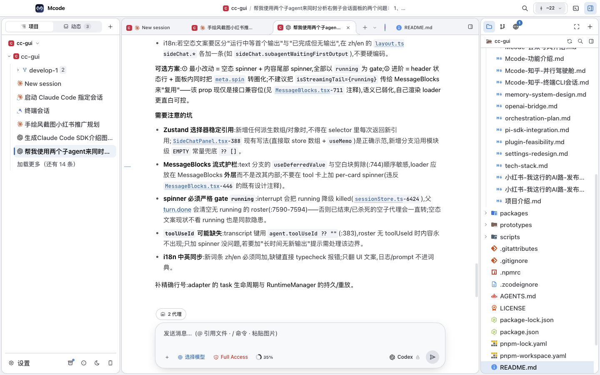

### Key highlights

- 🎛 **Five engines, one app** — Claude Code, OpenAI Codex, Pi, OpenCode, and Google Antigravity; pick the agent before each session starts
- 🔑 **Your subscription, not API billing** — Claude sessions run your own Claude Code CLI, so Claude Pro/Max logins just work; Antigravity sessions use your Google account / Gemini API key / GCP project
- 🛰 **Google Antigravity integration** — full Gemini agent sessions via the official `agy` CLI (ACP), with **multi-account switching** and a live quota bar
- 🖥 **Terminal CLI sessions** — run the raw `claude` / `codex` / `agy` / `pi` / `opencode` TUIs in app tabs, with scrollback restore and conversation resume
- ⚡ **Real-time streaming** — watch every token arrive as the agent works
- ✅ **Tool approval UI** — allow / always-allow (per session or globally) / deny with a per-session pending queue
- 📋 **Plan mode** — the agent researches and presents a plan for your approval before executing
- 🧠 **Auto-orchestration** — one session decomposes a goal into subtasks and dispatches parallel worker sessions on a visual canvas
- 🐙 **GitHub panel** — browse / comment / merge PRs, triage issues, and open fix PRs without leaving the app
- 🧩 **Plugins & MCP** — install agent plugins (skills / commands / MCP servers) from marketplaces, delivered to all engines
- 🌿 **Worktree sessions** — run parallel sessions on one repo in isolated git worktrees, merge back in one click
- 🧰 **Full IDE** — Monaco editor (30+ languages), diff view, multi-repo git, multi-tab terminal, PDF preview, Mermaid diagrams
- 🌐 **Embedded browser** — element picking + agent-driven browser automation, login state persists across restarts
- 🌍 **Language servers (LSP)** — TypeScript, Python, Go, Java — install and enable in one click
- 📱 **Mobile remote control** — watch, chat, approve, and rewind from your phone (LAN or SSH tunnel)
- 🆓 **MIT licensed** — free forever, no tracking, no account required

### Features

#### 🤖 Multi-provider agents

- Built-in providers: **Claude Code** (your own installed `claude` CLI, driven directly over its headless `stream-json` protocol — **no SDK, no bundled binary, no prompt injection**: the model gets the exact same official system prompt and tools as in your terminal), **OpenAI Codex** (`@openai/codex`), **Pi** (pi coding agent), **OpenCode** (opencode v2), and **Google Antigravity** (`agy acp`) — pick one in the composer before the first message of a session.
- Each provider declares its own capabilities and the UI adapts automatically: thinking levels / effort, permission modes, built-in models, custom endpoints.
- The **Claude and Codex providers support third-party model providers** — OpenAI-compatible / Anthropic-compatible endpoints configured in **Settings → Models** — with per-model overrides (context window, thinking mode, custom request headers). Third-party gateways, proxies, and 1M-token models all work.
- Per-role model assignment: normal chat, git commit-message generation, and merge-conflict resolution can each use a different model.

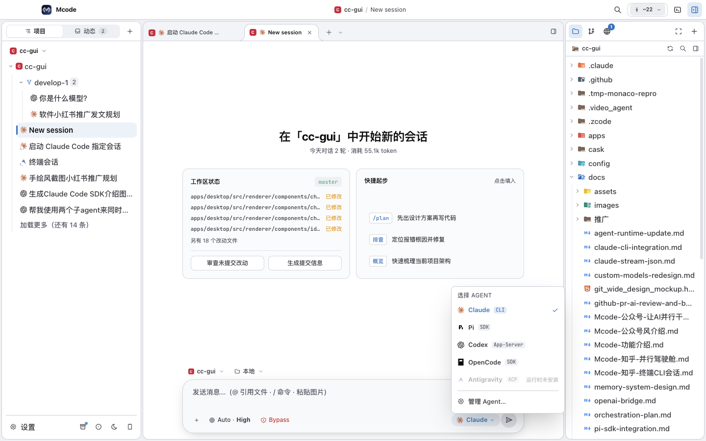

#### 🛰 Google Antigravity (Gemini)

Mcode integrates **Google Antigravity** — Google's agentic coding platform — through its official CLI (`agy`) in ACP mode (`agy acp`, JSON-RPC 2.0 over stdio). The agent loop, tools, and model calls all stay inside Google's own binary; Mcode renders the conversation, approvals, and quota.

**Why it's safe to use your account:**

- **Official client, official protocol.** Mcode spawns the unmodified `agy` binary published with [Antigravity](https://antigravity.google) and speaks its documented ACP interface — the same interface Google's own IDE uses. No reverse-engineered private endpoints, no request forgery, no tampering: what Google's backend sees is indistinguishable from a developer using the official CLI / IDE.
- **Your real credentials, your own machine.** Login goes through the CLI's own Google OAuth flow (`agy acp --login`) or your own Gemini API key / GCP project. Mcode never shares credentials, never pools accounts, and never sends requests on behalf of anyone else.
- **Isolated profiles per account.** Every saved account gets its own isolated `--gemini-dir` home (settings, conversations, annotations). Your default `~/.gemini` and your Antigravity IDE login are never touched, and accounts never mix — switching an account looks to Google exactly like a person signing into that account.
- **Quota-transparent.** The usage bar reads quotas via `agy -p /usage`, verified to consume **zero quota** (with an automatic safety latch that disables polling if a future CLI version ever starts billing it).
- In short: Mcode adds a GUI on top of normal, personal use of the official client — the least suspicious traffic pattern there is. As with any Google service, keep usage within their terms of service.

**Multi-account:** save and switch between multiple Google accounts (captured from your `agy` logins), Gemini API keys (with optional custom base URL), and GCP / Vertex AI projects. Each account keeps its own isolated home directory; secrets are encrypted with Electron `safeStorage`; the active account applies to new sessions and can be switched anytime from the composer's account dialog.

**Full agent experience:** streaming, tool approvals, plan mode, AskUserQuestion, MCP servers, and effort levels (`minimal` → `max`) all work; the model list is probed from the CLI and effort variants are folded into a single model + effort slider.

> The ACP dialect lessons (tool-call shape normalization, `interaction_` prompts as user questions, security-warning surfacing) build on the excellent work of [stablyai/orca](https://github.com/stablyai/orca).

#### 💬 Real-time conversation & multi-session

- Messages stream in live, token by token, rendered as structured cards (assistant text, thinking, tool calls, tool results, images, Mermaid diagrams, generated videos).
- Tool-use approvals: allow / always-allow (this session or globally) / deny, with a per-session pending queue.
- Plan mode: the agent researches first and presents a plan for your approval before executing.
- Activity console: subagents, background bash commands (with live output), running services (with port-level detection and one-click stop), plans, and bookmarks for the running turn, gathered in one place.
- Per-turn file snapshots with one-click "rewind this turn" — restores the exact files the agent touched, on any historical turn.
- Split view: up to 4 sessions side-by-side (2×2) with a shared composer; fork any session to explore a branch of the conversation.
- Attach files, paste images, `@`-reference files, use slash commands, and dictate with **voice input** from the composer.
- Sessions persist to SQLite (better-sqlite3) and can be resumed later; auto-archiving keeps the session list clean.


#### 🧠 Auto-orchestration

- Turn on the orchestration switch in the composer and describe a goal: the agent decomposes it into subtasks on a **visual plan canvas**, dispatches parallel worker sessions, waits on decision gates, and merges the results.
- Workers are ordinary sessions — full approval, checkpoint, and streaming support — supervised from one canvas.
- Works with any provider; the planner uses your configured models with per-role budgets.

#### 🖥 Terminal CLI sessions

- Besides GUI sessions, Mcode hosts **raw interactive CLI sessions** in terminal tabs: `claude`, `codex`, `agy`, `pi`, and `opencode` — the exact TUIs you'd get in your own terminal, with zero protocol glue.
- Scrollback is snapshotted and restored when you reopen a session, and the underlying conversation is resumed (`--resume` / conversation adoption), so closing a tab doesn't lose the thread.
- Sessions auto-name themselves from their content; missing CLIs can be installed/updated right from **Settings → Runtimes** (npm-managed ones), and CLI version requirements are checked per provider.
- Imported sessions: terminal Pi conversations recorded on disk are discovered and imported as regular searchable chat sessions.

#### 🗂 Projects & sessions in the left sidebar

- Two sidebar modes: the classic **project tree**, and an inbox-style **session stream** that lists sessions across projects with scope filters (project / group / worktree).
- Multi-project management with grouping, pinning, reordering, archiving; per-project session history with search.
- 🌿 **Git worktree sessions**: start a session in an isolated worktree of the same repo to run parallel threads without interference; merge the worktree back with one click (auto-commits uncommitted changes first).

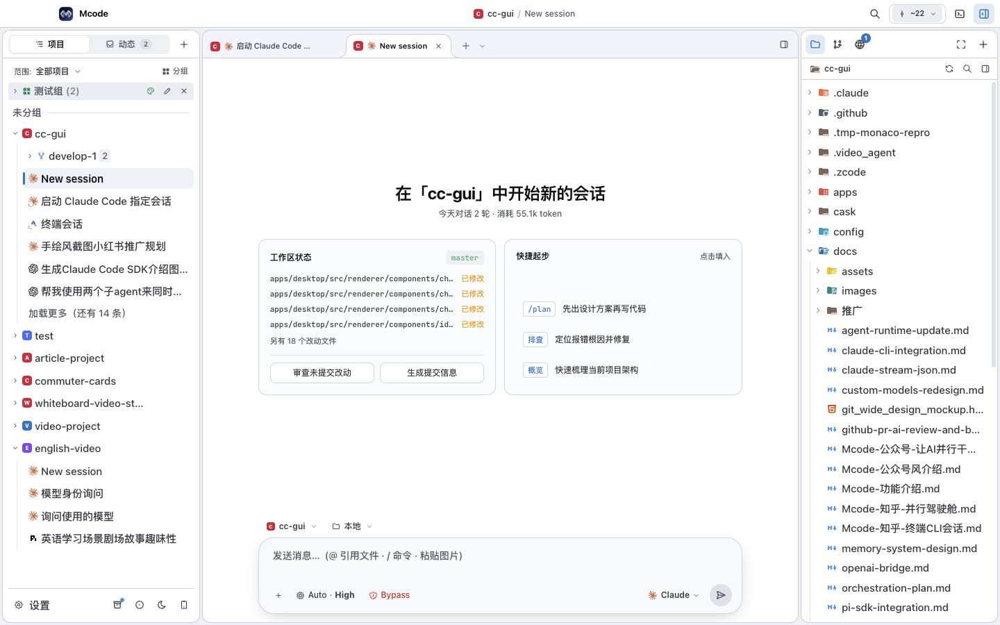

#### 📁 File tree & editor (right panel)

- File tree of the current project with "agent-touched" markers (new / modified this turn).
- Monaco editor with 30+ languages, dirty-state indicators, and find & replace.
- Three file views: **Edit** (Monaco), **Diff** (Monaco DiffEditor side-by-side), **Preview** (Markdown with syntax highlighting & math, Mermaid diagrams, images & video, PDF rendering, friendly binary fallback).
- Wide-panel layout mode with a drag-adjustable split for code-heavy work.
- Context menu (reveal in explorer, copy paths, add to chat) and drag-a-file-into-the-conversation.

<table>
  <tr>
    <td>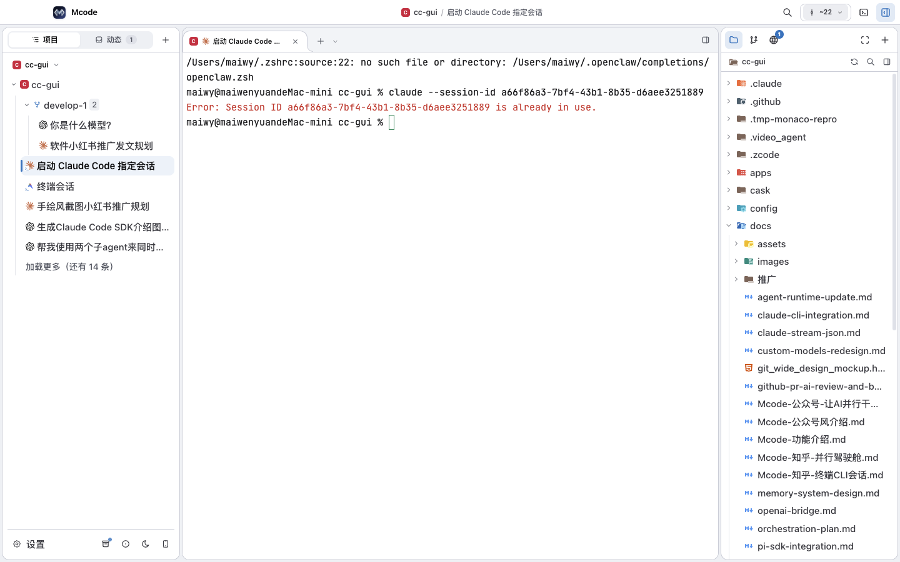</td>
    <td>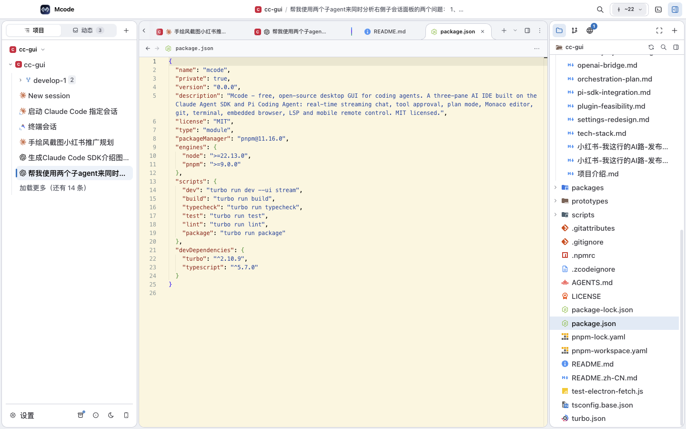</td>
  </tr>
</table>

#### 🧰 Git management (multi-repo)

- Recursively discovers **multiple repos** inside one project (monorepos, submodules, nested checkouts) — one card per repo.
- Stage / unstage / discard, line-level diffs in Monaco DiffEditor, branch switcher, local-branch deletion, history view, per-repo operation log.
- All operations run through a per-repo serialized queue with stale `index.lock` self-healing — no more intermittent "index.lock: File exists" failures on submodule repos.
- ✨ **AI commit message**: reads the diff and drafts a conventional-commit style message; **AI merge-conflict resolution** offers a guided, conversation-style "resolve with AI" flow after a conflicted pull.

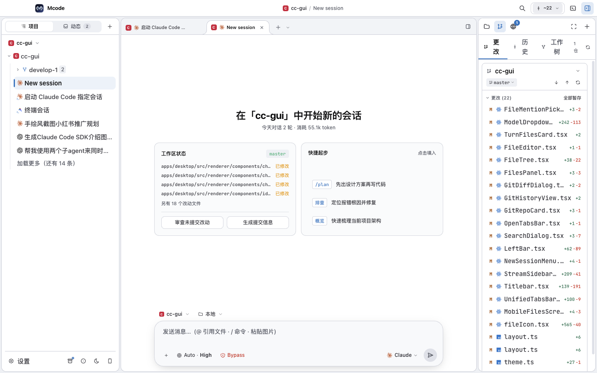

#### 🐙 GitHub PR & issue panel

- A dedicated right-panel tab for **github.com repos**: browse pull requests and issues with state badges, read bodies & comments rendered as Markdown.
- Review PR details (mergeable-state warnings, changed-file stats), comment, **merge** (squash / merge / rebase, optional branch deletion), close & reopen.
- Triage issues with linked-PR timelines, then open a **fix PR** in one flow: pick a local branch, auto-push with upstream, attach `Fixes #N` references, file as draft if you like.
- Token stored encrypted (safeStorage) with `gh` CLI fallback; works with manually added `owner/repo` entries even without a local git remote.

#### 🖥 Built-in terminal (bottom)

- Multi-tab terminal (xterm.js + node-pty) with status indicators; switching projects never kills background terminals (keep-alive).
- Per-project custom commands: bookmark your frequent commands and run them with one click.

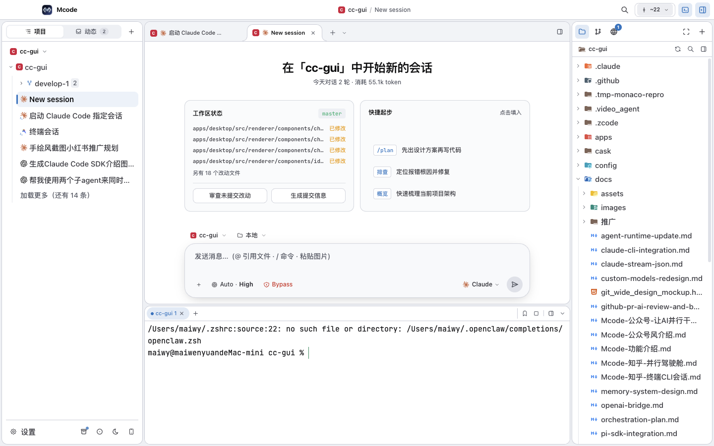

#### 🌐 Embedded browser (right panel)

- Multi-tab browser panel on top of the main window; closing the panel keeps pages alive, and logins persist across app restarts.
- Bookmarks, history, downloads, and privacy cleanup (clear cookies / cache / history).
- Device presets (desktop / iPhone / Android) with real viewport & touch emulation; popups and new windows open as in-app tabs.
- 🎯 Element picking: hover, click, and send the element's HTML + stable selector straight into the conversation for the agent to work on.
- The agent itself can also drive the browser (navigate / snapshot / click / type / screenshot, with real input events) through built-in tools.

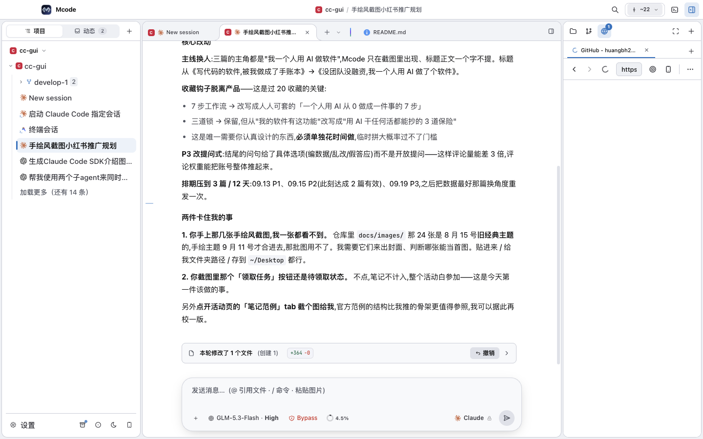

#### 🧩 Plugins & MCP servers

- Install agent plugins from a marketplace (git repo / local folder / zip) or browse marketplace catalogs; installs land **disabled**, with a component-review dialog before you enable anything.
- One plugin can carry skills, slash commands, subagents, MCP servers, and hooks — Mcode delivers them to **all engines** and shows a per-component support matrix (hooks are parsed but never executed in v1).
- Manage **MCP servers** in Settings → MCP: stdio / HTTP servers, per-server enable, and OAuth login for remote servers.

#### 🌍 Language servers (LSP)

- Installable and toggleable language servers for TypeScript/JavaScript, Python (basedpyright), Go (gopls), and Java (jdtls).
- Definition / references / hover in Monaco, plus live diagnostics markers as you type.

#### 📱 Mobile companion

- **LAN access**: Mcode serves a companion web app over the local network — scan the QR code on your desktop to pair your phone (device-token auth).
- **Remote access from anywhere**: connect through your own VPS via an SSH reverse tunnel — no third-party tunneling service required.
- The phone is a full remote control: watch sessions stream live, send messages, interrupt or rewind turns, approve tool calls, browse files & diffs, and run git operations (including AI commit messages).

<table>
  <tr>
    <td>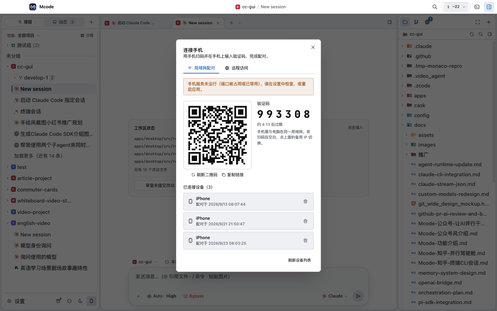</td>
    <td>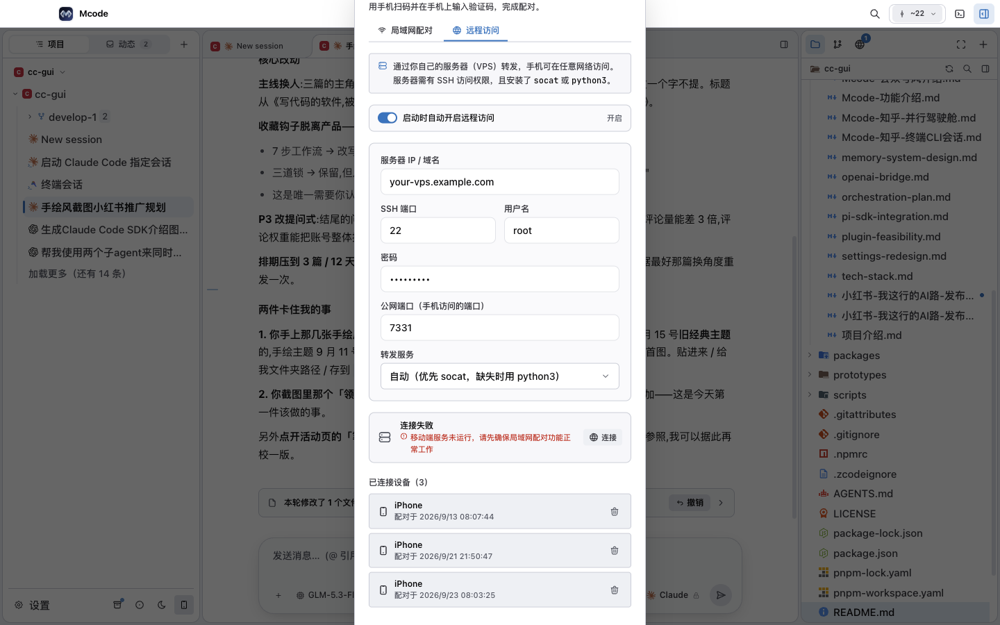</td>
  </tr>
</table>

#### ⚙️ Rich settings

**General** — session title generation preferences.

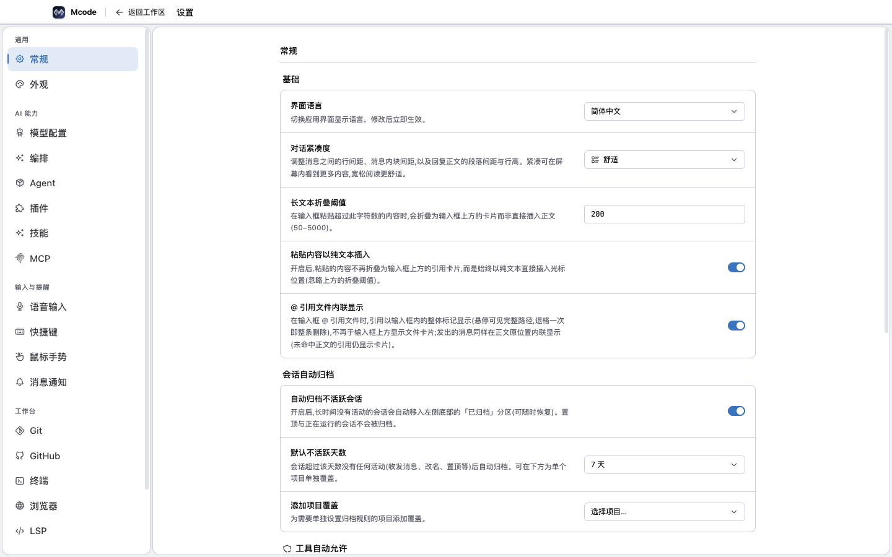

**Appearance** — theme, hand-drawn sketch style (paper light / kraft dark), UI font family, chat font size, and density.

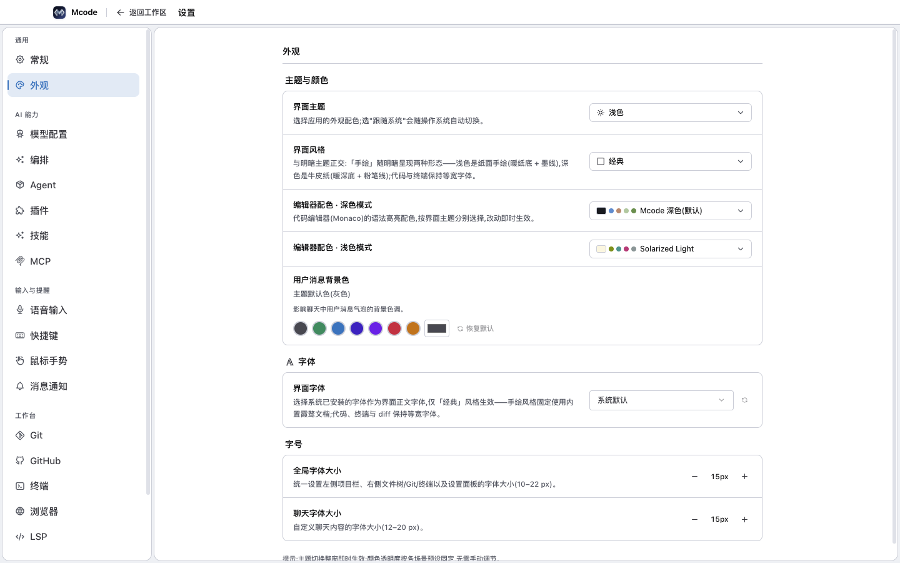

**Shortcuts** — view and record keyboard shortcuts.

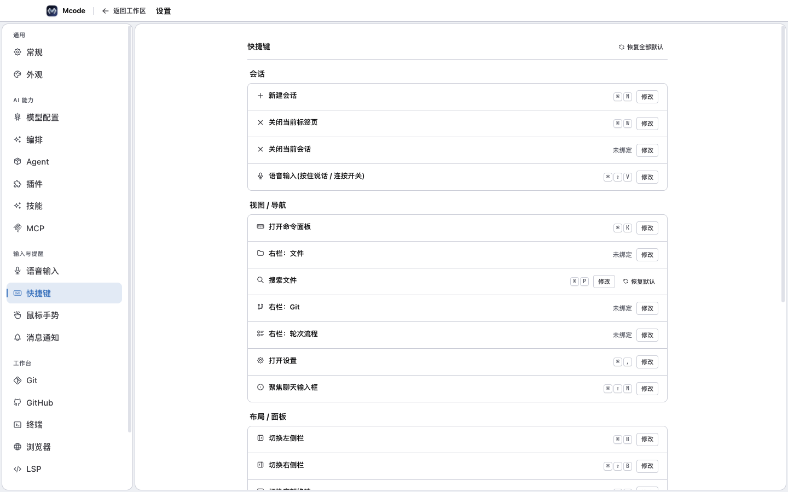

**Models** — provider & custom model configuration (OpenAI-compatible / Anthropic-compatible endpoints, per-model thinking modes, custom request headers, subagent model pinning).

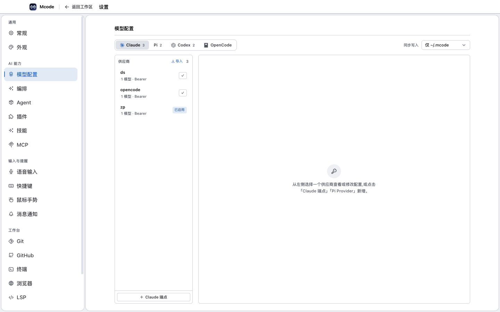

**Skills** — manage agent skills with a built-in SKILL.md editor.

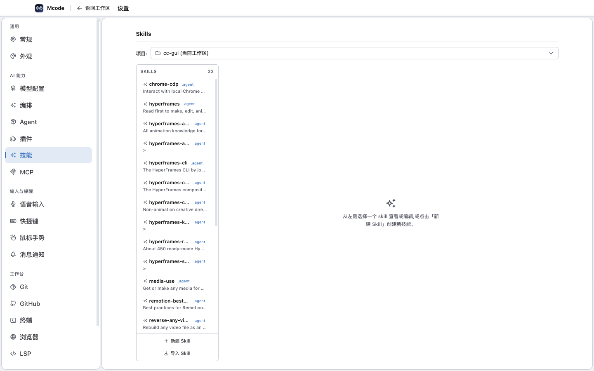

**Notifications** — toggle notifications per category.

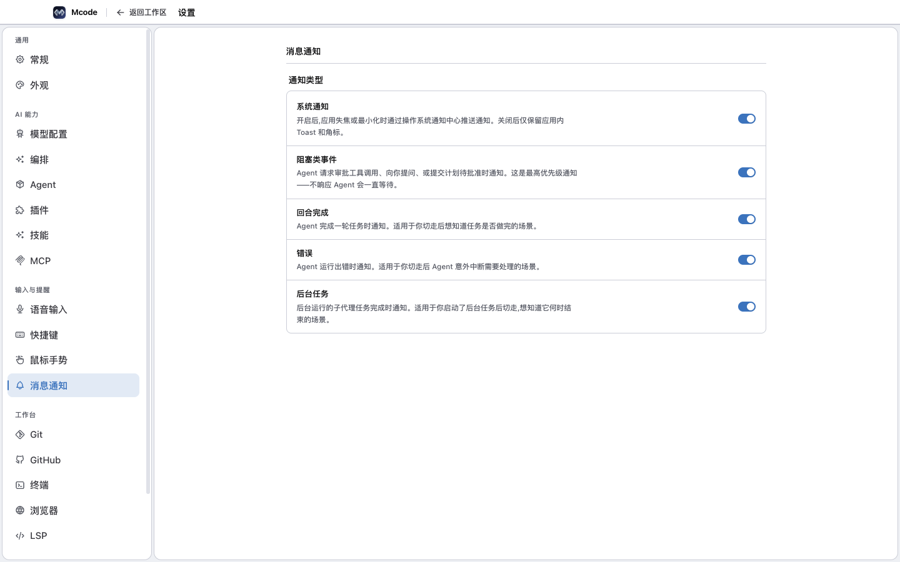

**Git** — author identity, diff options, and the model used for AI commit messages.

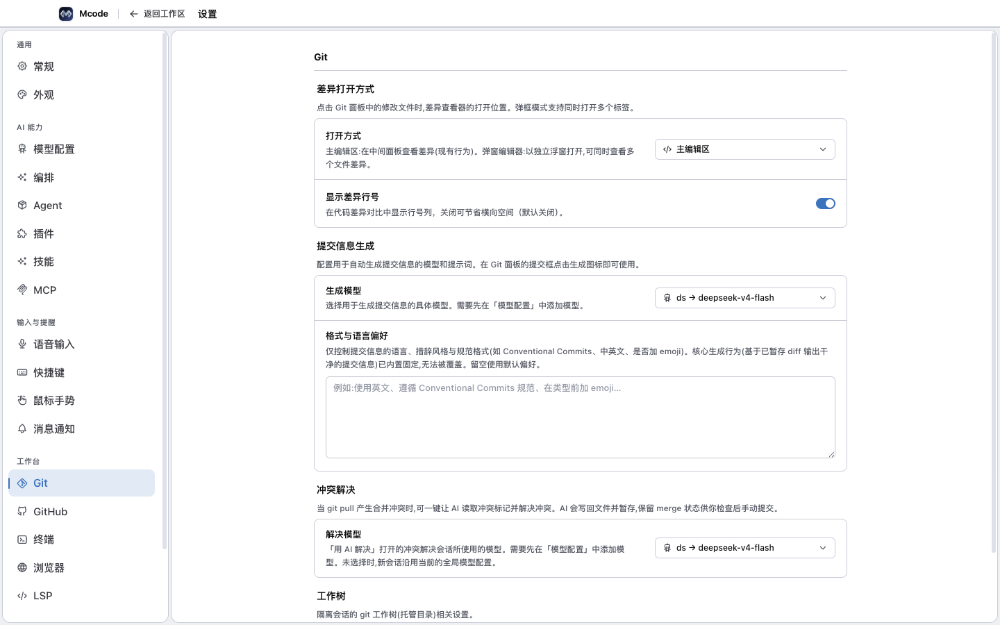

**Terminal** — shell override and per-project custom commands.

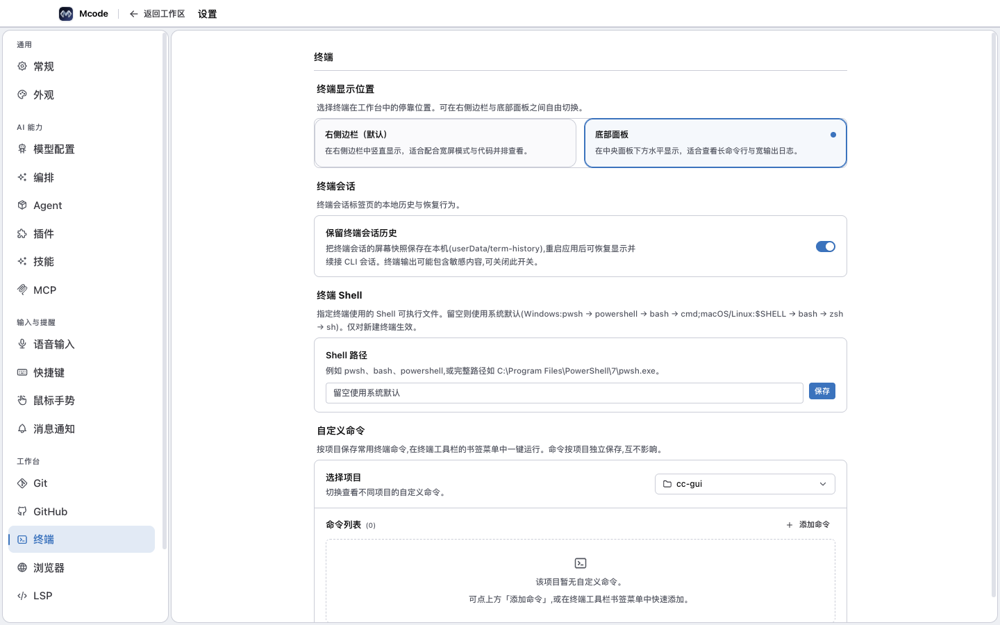

**Browser** — embedded browser preferences.

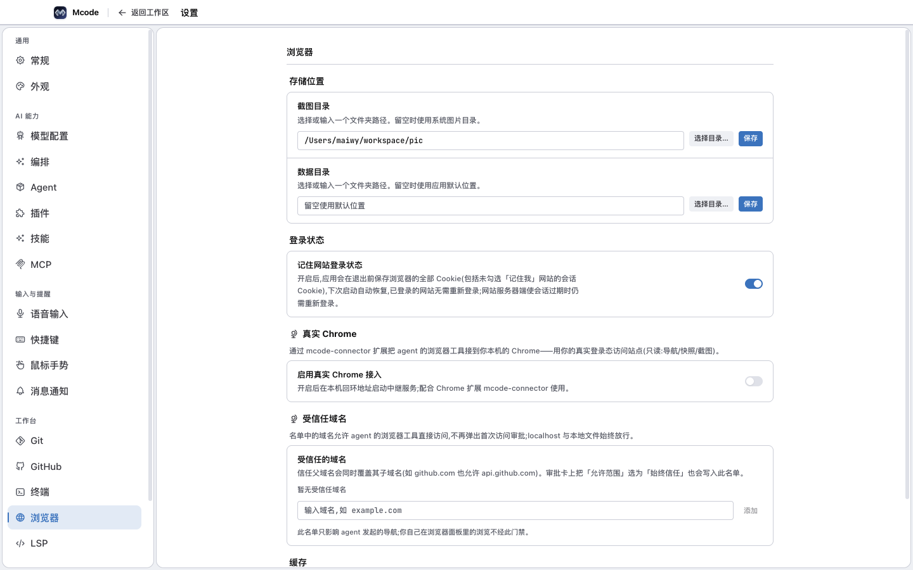

**Language servers** — install, enable, and disable LSP servers per language.

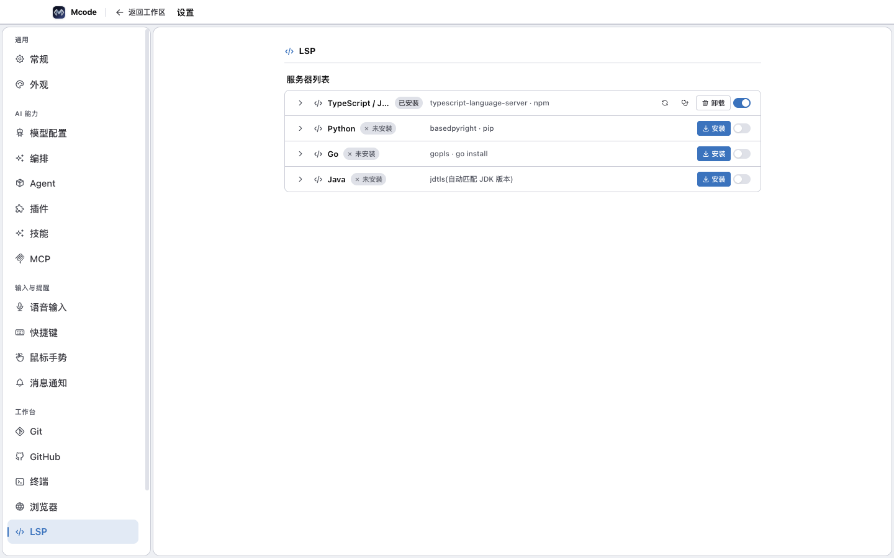

Plus: **Mouse gestures** (record drag gestures bound to app commands), **Voice input**, **MCP servers**, **Plugins**, **Runtimes** (install / update the Codex & Pi runtimes and manage terminal CLIs; the Claude CLI is your own and is not managed here), **Usage** (token usage statistics), and **About**.

#### 🔄 Other

- **On-demand runtimes** — the Codex and Pi runtimes are not bundled with the installer; Mcode downloads them automatically on first use. The Claude Code and Antigravity CLIs are **yours** — Mcode finds them on PATH and follows whatever version you keep installed (minimum versions are enforced per provider with clear upgrade hints).
- Auto-update via `electron-updater` (pulls `latest*.yml` from GitHub Releases); manual check in **Settings → About**.
- Provider abstraction layer (`AgentProvider`) — five engines today, easy to extend to other agent platforms.

### FAQ

**Q: Is Mcode free?**
A: Yes — Mcode is open source under the **MIT license**, free to use and modify.

**Q: Does Mcode work on macOS and Windows?**
A: Yes. Pre-built installers are published for macOS (Apple Silicon + Intel) and Windows (x64). See [Download](#download) below.

**Q: Do I need to install the Claude Code CLI separately?**
A: **Yes, for Claude sessions** — and that's a feature: Mcode runs *your own* `claude` CLI (`npm i -g @anthropic-ai/claude-code` or the native installer), so you get the same version, login, and behavior as your terminal. Mcode locates it automatically and enforces a minimum version (2.1.218+) with a clear upgrade hint. The Codex and Pi runtimes are still downloaded automatically by Mcode; the Antigravity CLI ships with the Antigravity IDE / installer.

**Q: Can I use my Claude Pro/Max subscription?**
A: Yes. Because sessions run your own Claude CLI, whatever login the CLI has — including **Pro/Max subscriptions** — works. API keys and third-party Anthropic-compatible endpoints are supported too (Settings → Models).

**Q: Which models can I use?**
A: Claude: your CLI's login (Pro/Max or API key) or custom endpoints. Codex: OpenAI or any OpenAI-compatible / Responses API endpoint. Pi & OpenCode: models configured in **Settings → Models**. Antigravity: your Google account (Antigravity login), a Gemini API key, or a GCP / Vertex AI project — with multi-account switching.

**Q: Is the Antigravity integration safe for my Google account?**
A: Mcode launches the **official, unmodified `agy` CLI** and speaks its **official ACP protocol** — the same binary and interface Google's own IDE uses. There are no reverse-engineered APIs and no credential tricks; each saved account lives in an isolated profile directory, and quota checks run through the CLI's own zero-cost usage command. See the [Antigravity section](#-google-antigravity-gemini) for details.

**Q: Can I control Mcode from my phone?**
A: Yes — scan the QR code for LAN access, or connect through your own VPS via an **SSH reverse tunnel** for remote access from anywhere.

### Requirements

- Node.js ≥ 22.13 (pnpm 11 requires it)
- pnpm ≥ 9 (`corepack enable && corepack prepare pnpm@latest --activate`)
- **Claude provider**: the [Claude Code CLI](https://code.claude.com/docs/en/quickstart) installed and logged in (`npm i -g @anthropic-ai/claude-code`, then `claude` to log in) — version 2.1.218+. Your Pro/Max subscription or API key works.
- **Codex / Pi / OpenCode providers**: configure models in **Settings → Models** (official or any OpenAI-compatible / Responses API endpoint); runtimes are downloaded automatically on first use. API keys entered there are encrypted with Electron `safeStorage`.
- **Antigravity provider**: the Antigravity CLI (`agy`, installed with the [Antigravity IDE](https://antigravity.google)) — version 1.5.5+, logged in via `agy acp --login`, or configure Gemini API key / GCP accounts inside Mcode.

> **Note:** For Codex and Pi, no CLI needs to be installed manually — Mcode downloads the required runtime automatically on first use, so the first use of a provider needs network access.

### Getting started

```bash
pnpm install
pnpm dev
```

### Build & package

```bash
# Type-check
pnpm typecheck

# Build (electron-vite)
pnpm build

# Package installers (macOS dmg/zip + Windows nsis) -> apps/desktop/release/
pnpm package
```

### Download

Pre-built binaries are published on [GitHub Releases](https://github.com/huangbh2020/mcode/releases):

- **macOS**: `.dmg` (arm64 + x64)
- **Windows**: `.exe` NSIS installer (x64)

> ⚠️ **Not code-signed.** Mcode is a free MIT project without a paid Apple Developer ID or a Windows code-signing certificate, so the installers are ad-hoc signed (macOS) / unsigned (Windows). Your OS will warn on first launch — this is expected and safe. See the workarounds below.

#### First-launch notes

**macOS** — Gatekeeper blocks the app with *"Mcode cannot be opened because Apple cannot check it for malicious software"* / *"cannot verify the developer"*:

- **macOS 15 (Sequoia) and earlier**: right-click the app → **Open** → confirm in the dialog.
- **macOS 26+**: right-click → Open no longer works. Open **System Settings → Privacy & Security**, scroll down, and click **Open Anyway**.
- **Terminal (works on all versions)**:
  ```bash
  xattr -dr com.apple.quarantine /Applications/Mcode.app
  ```
- **Homebrew (no warning at all)**: `brew install --cask mcode` — the cask strips the quarantine attribute at install time.

**Windows** — SmartScreen shows *"Windows protected your PC"* / *"Unknown publisher"*:

- Click **More info** → **Run anyway**.
- The installer (NSIS) is per-user and can be installed without administrator rights.

### Tech stack

| Layer | Technology |
|-------|-----------|
| Shell | Electron 37, electron-vite, electron-builder 25 |
| Frontend | React 19, Zustand 5, Tailwind CSS 3, @base-ui/react, @tabler/icons |
| Editor / Terminal | Monaco Editor, xterm.js + node-pty |
| Agent engines | Claude Code CLI (direct spawn, stream-json protocol) · @openai/codex · pi coding agent · opencode v2 · Antigravity `agy` CLI (ACP) |
| Persistence | better-sqlite3 (synchronous SQLite) |
| Contracts | zod (cross-process IPC validation) |
| Tooling | pnpm 11, Turbo, TypeScript 5 (strict) |

### License

MIT. This project does not redistribute or bundle any agent binary: the Claude Code and Antigravity CLIs are installed by you and launched as-is, and the Codex / Pi / OpenCode runtimes are fetched from their official npm packages on demand.

### Community

Join the Mcode user group on WeChat — scan the QR code below to ask questions, share feedback, or just chat about the project:


> Group QR codes expire — if the code is no longer valid or the group is full, please open an [issue](https://github.com/huangbh2020/mcode/issues) to reach us.

---

If Mcode helps you, please ⭐ star the project and share it with others — every share helps more people discover it.
