# Mcode


**Mcode** — *my* Code。免费开源的 **Claude Code / Codex / Gemini Antigravity / 编程 Agent 桌面客户端**。

[English](README.md) | **简体中文**

---

### Mcode 是什么？

**Mcode** 是一款免费开源的**编程 Agent 桌面客户端**——一个**三栏 IDE**,把 **Claude Code**、**OpenAI Codex**、**Pi**、**OpenCode** 与 **Google Antigravity** 装进完整的桌面应用。Mcode **不重新实现 agent**、**自己不调模型 API**:它拉起你机器上**已有的官方 agent 引擎**,渲染它们的原生协议——Claude 走你自己安装的 **Claude Code CLI** 的无头 `stream-json` 协议(中间没有任何 Agent SDK);Antigravity 走 Google `agy` CLI 的官方 **ACP**(Agent Client Protocol)模式。Mcode 只提供完整的交互界面:会话管理、**实时流式渲染**、可视化**工具审批**、**计划模式**,以及文件树、Monaco 编辑器(30+ 语言)、**Git**、**终端**、**内置浏览器**、**语言服务器(LSP)**等全套 IDE 能力,并支持**手机端远程控制**。

因为 agent 跑的是**你自己的引擎、你自己的登录态**,**Claude Pro/Max 订阅开箱即用**——不需要 API key。

> **搜索关键词:** Claude Code 桌面版 · Codex 桌面客户端 · Gemini Antigravity 桌面客户端 · Claude 客户端 · 开源 AI IDE · AI 编程助手 · 工具审批 UI


### 操作演示

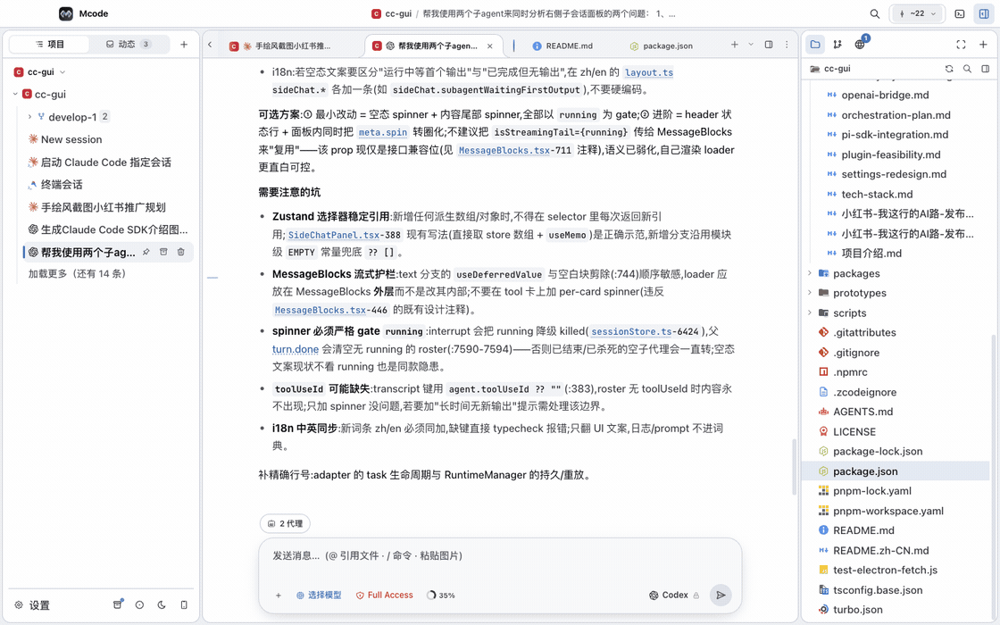

### 核心亮点

- 🎛 **五个引擎,一个应用** —— Claude Code、OpenAI Codex、Pi、OpenCode、Google Antigravity,会话前自由切换
- 🔑 **用订阅,不按 API 计费** —— Claude 会话跑你自己的 Claude Code CLI,Pro/Max 登录直接可用;Antigravity 会话用你的 Google 账号 / Gemini API key / GCP 项目
- 🛰 **Google Antigravity 集成** —— 经官方 `agy` CLI(ACP)跑完整 Gemini agent 会话,支持**多账号切换**与实时配额条
- 🖥 **终端 CLI 会话** —— 在应用标签页里跑原生 `claude` / `codex` / `agy` / `pi` / `opencode` TUI,画面可恢复、对话可续接
- ⚡ **实时流式输出** —— agent 的每一个 token 实时呈现
- ✅ **工具审批界面** —— 允许 / 始终允许(本会话或全局)/ 拒绝,按会话维护待审批队列
- 📋 **计划模式** —— 先只读调研、给出计划等你批准,再动手执行
- 🧠 **自动编排** —— 一个会话把目标拆解成子任务,在可视化画布上派发并行 worker 会话
- 🐙 **GitHub 面板** —— 浏览 / 评论 / 合并 PR、处理 Issue、发起修复 PR,不用离开应用
- 🧩 **插件与 MCP** —— 从插件市场安装 agent 插件(skills / 命令 / MCP server),投递给所有引擎
- 🌿 **工作树会话** —— 在隔离的 git worktree 中并行开会话,一键合并回主检出
- 🧰 **全套 IDE** —— Monaco 编辑器(30+ 语言)、diff 对比、多仓库 Git、多标签终端、PDF 预览、Mermaid 图表
- 🌐 **内置浏览器** —— 元素拾取 + agent 自动驱动浏览器,登录状态跨重启保留
- 🌍 **语言服务器(LSP)** —— TypeScript / Python / Go / Java 一键安装启用
- 📱 **手机端遥控** —— 手机上看会话、发消息、审批、撤销(局域网 / SSH 隧道)
- 🆓 **MIT 开源** —— 永久免费,无追踪、无账号

### 功能特性

#### 🤖 多 Agent Provider

- 内置五个 provider:**Claude Code**(你本机安装的 `claude` CLI,直接以无头 `stream-json` 协议驱动——**无 SDK、无捆绑二进制、无提示词注入**:模型拿到的系统提示词与工具集和你终端里完全一样)、**OpenAI Codex**(`@openai/codex`)、**Pi**(pi coding agent)、**OpenCode**(opencode v2)、**Google Antigravity**(`agy acp`),会话首条消息前可在输入框选择。
- 每个 provider 声明自己的能力,UI 自动适配:思考级别 / effort、权限模式、内置模型、自定义端点支持。
- **Claude 与 Codex 都支持第三方模型供应商**——在**设置 → 模型配置**里配置 OpenAI 协议 / Anthropic 协议端点,支持按模型覆盖上下文窗口、思考模式、自定义请求头。第三方网关、中转、1M token 模型都能用。
- 按角色分配模型:普通对话、提交信息生成、合并冲突解决可分别使用不同的模型。

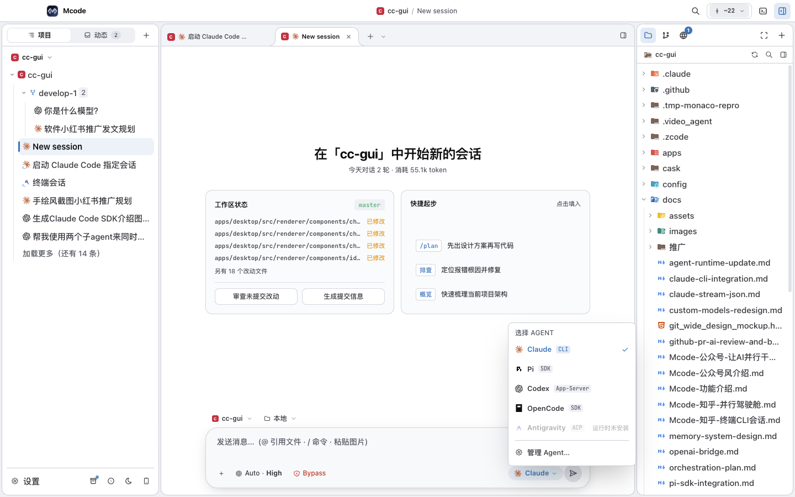

#### 🛰 Google Antigravity(Gemini)

Mcode 通过 **Google Antigravity** 官方 CLI(`agy`)的 ACP 模式(`agy acp`,stdio 上的 JSON-RPC 2.0)接入 Google 的 agentic 编程平台。agent loop、工具与模型调用全部留在 Google 自己的二进制里,Mcode 只负责渲染对话、审批与配额。

**为什么可以放心用你的账号:**

- **官方客户端,官方协议。** Mcode 拉起的是 [Antigravity](https://antigravity.google) 随附的**未经修改**的 `agy` 二进制,说它文档化的 ACP 接口——与 Google 自家 IDE 用的同一个接口。没有逆向的私有端点、没有请求伪造、没有任何篡改:Google 后端看到的流量,和一个开发者正常使用官方 CLI / IDE 没有任何区别。
- **真实凭据,本人设备。** 登录走 CLI 自己的 Google OAuth 流程(`agy acp --login`),或用你自己的 Gemini API key / GCP 项目。Mcode 不共享凭据、不池化账号、绝不替别人发请求。
- **每账号独立隔离。** 每个保存的账号都有独立的 `--gemini-dir` 隔离家目录(配置、会话记录、标注各自独立)。你的默认 `~/.gemini` 与 Antigravity IDE 登录态永不触碰,账号之间互不混杂——切换账号在 Google 眼里就是一个人正常登录了那个账号。
- **配额透明。** 用量条经 `agy -p /usage` 读取,已验证**零配额消耗**(并带安全闩:若未来某个 CLI 版本把它计为真实回合,自动永久停用轮询)。
- 一句话:Mcode 只是在"正常、个人地使用官方客户端"之上加了一层图形界面——这是最不可能引起风控注意的使用模式。当然,任何 Google 服务都请在服务条款范围内正常使用。

**多账号:** 可保存并切换多个 Google 账号(从你的 `agy` 登录捕获)、多个 Gemini API key(支持自定义 base URL)、多个 GCP / Vertex AI 项目。每个账号有独立隔离的家目录;密钥用 Electron `safeStorage` 加密;当前账号对新会话生效,随时可在输入框的账号弹窗里切换。

**完整 agent 体验:** 流式输出、工具审批、计划模式、AskUserQuestion、MCP server、effort 档位(`minimal` → `max`)全部可用;模型清单从 CLI 实时探测,effort 变体折叠成"一个模型 + 一个思考滑杆"。

> ACP 方言的适配经验(工具调用形态归一、`interaction_` 提示按用户提问处理、安全警告呈现等)参考了 [stablyai/orca](https://github.com/stablyai/orca) 的优秀工作。

#### 💬 实时对话与多会话

- 消息按 token 实时流式渲染;assistant 消息、思考过程、工具调用、工具结果、图片、Mermaid 图表、生成的视频以**结构化卡片**展示。
- 工具审批:允许 / 始终允许(本会话或全局)/ 拒绝,每个会话独立维护待审批队列。
- 计划模式(Plan Mode):agent 先只读调研、给出计划等你批准,再动手执行。
- 活动台:运行回合中的子代理、后台 bash 命令(带实时输出)、运行中的服务(端口级检测 + 一键停止)、计划、书签集中一处查看。
- 每轮文件快照 + 一键「撤销本轮」——精确回滚 agent 本轮改过的文件,历史轮次也能撤。
- 分屏视图:最多 4 个会话并排(2×2)、共享输入框;任意会话可**分叉(fork)**出一条分支继续探索。
- 输入框支持附加文件、粘贴图片、`@` 引用文件、斜杠命令与**语音输入**。
- 会话持久化到 SQLite(better-sqlite3),支持后续续传;自动归档保持会话列表整洁。

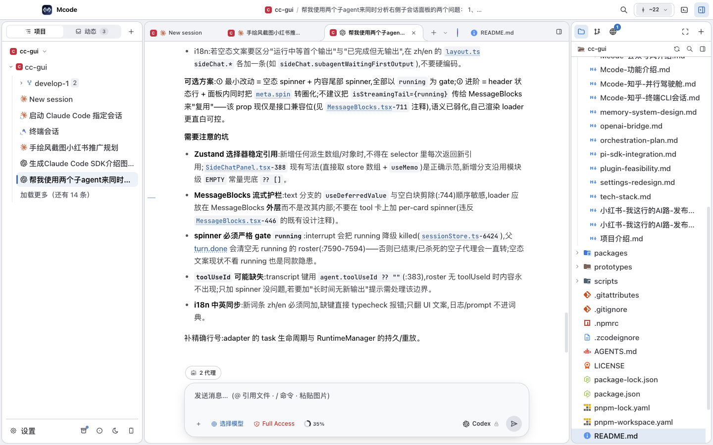

#### 🧠 自动编排

- 打开输入框的编排开关,描述一个目标:agent 会在**可视化计划画布**上拆解子任务、派发并行 worker 会话、在决策门等待、最后汇总结果。
- worker 就是普通会话——审批、快照、流式渲染全套支持,在一张画布上统一监督。
- 任意 provider 可用;规划者使用你配置的模型,预算按角色分配。

#### 🖥 终端 CLI 会话

- 除了 GUI 会话,Mcode 还能在终端标签页里托管**原生交互式 CLI 会话**:`claude`、`codex`、`agy`、`pi`、`opencode`——和你在自己终端里看到的 TUI 一模一样,零协议胶水。
- 画面快照在重开会话时回放,底层对话自动续接(`--resume` / 会话收养),关掉标签页不丢线程。
- 会话按内容自动起名;缺 CLI 可直接在**设置 → 运行时**安装/更新(npm 管理的几家),各 provider 有最低版本检查与升级提示。
- 会话导入:终端 Pi 会话落盘的记录会被扫描并导入为普通可搜索的聊天会话。

#### 🗂 左侧边栏:项目与会话管理

- 左栏双模式:经典**项目树**,以及跨项目的收件箱式**会话流**(支持按项目 / 分组 / 工作树过滤)。
- 多项目管理:分组、置顶、排序、归档;每个项目独立维护会话历史,支持搜索。
- 🌿 **工作树会话**:在同一仓库的隔离 worktree 中开并行会话,互不干扰;一键合并回主检出(合并前自动提交未提交改动)。

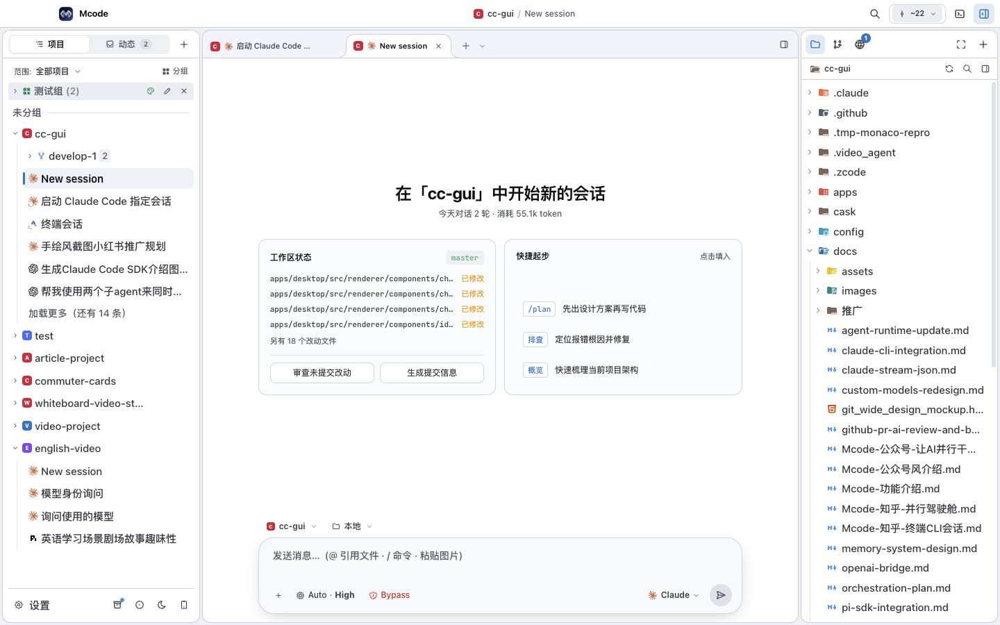

#### 📁 右侧边栏:文件树与编辑器

- 当前项目的文件树,带"agent 改动"标记(本轮新建 / 修改的文件一目了然)。
- Monaco 编辑器:30+ 语言支持、脏标记、查找替换。
- 三态文件视图:**编辑**(Monaco)、**Diff**(Monaco DiffEditor 并排对比)、**预览**(Markdown 语法高亮 + 数学公式、Mermaid 图表、图片视频、PDF 渲染、二进制文件友好提示)。
- 宽面板布局模式,分栏宽度可拖拽调整,适合重代码场景。
- 右键菜单(在资源管理器中显示、复制路径、添加到聊天)+ 拖拽文件直接送入对话。

<table>
  <tr>
    <td>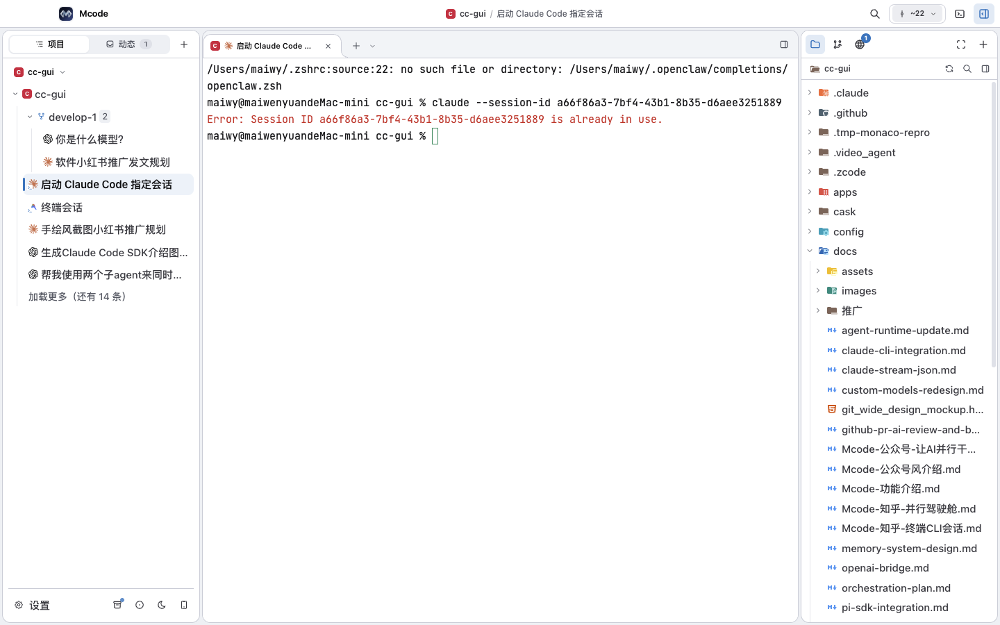</td>
    <td>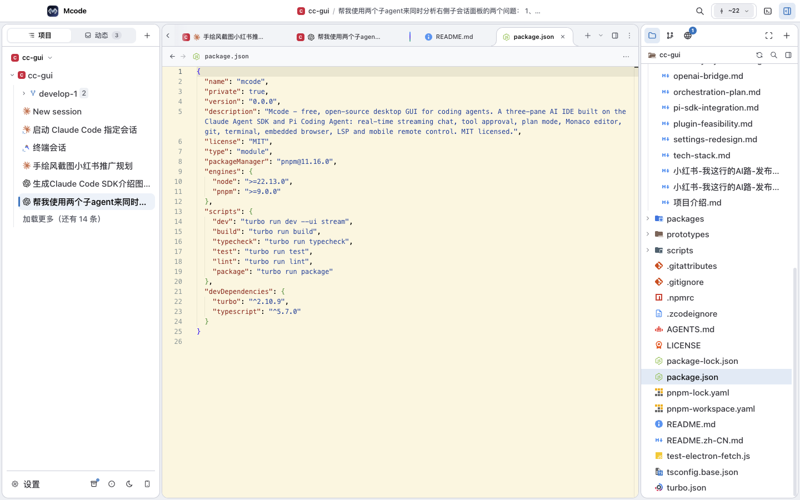</td>
  </tr>
</table>

#### 🧰 Git 管理(多仓库)

- 递归扫描自动发现一个项目里的**多个仓库**(monorepo、子模块、嵌套工程),每个仓库一张独立卡片。
- 暂存 / 取消暂存 / 丢弃、Monaco 行级 diff、分支切换器、本地分支删除、提交历史、每仓操作日志。
- 所有操作经 per-repo 串行队列执行,并带陈旧 `index.lock` 自愈——子模块仓库不再间歇性报「index.lock: File exists」。
- ✨ **AI 生成提交信息**:读取 diff 起草符合 conventional commit 风格的 message;**AI 解决合并冲突**:pull 冲突后提供会话式的"用 AI 解决"引导流程。

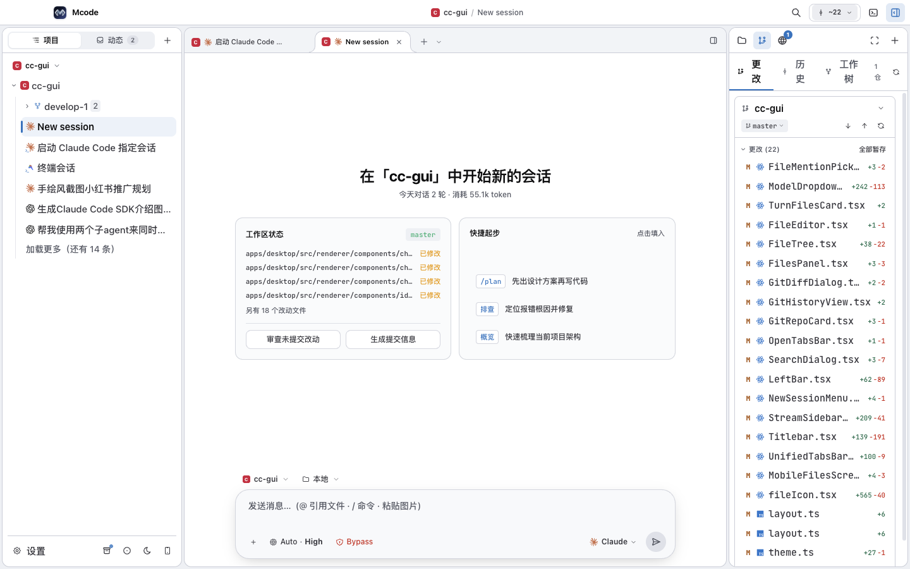

#### 🐙 GitHub PR / Issue 面板

- 右栏专属标签页管理 **github.com 仓库**:浏览 PR 与 Issue(状态徽标),正文与评论按 Markdown 渲染。
- 查看 PR 详情(可合并状态警示、变更文件统计)、评论、**合并**(squash / merge / rebase,可选删除源分支)、关闭与重开。
- 处理 Issue 时展示关联 PR 时间线,一条流程发起**修复 PR**:选本地分支、自动 push(带 upstream)、追加 `Fixes #N` 引用、可存为草稿。
- Token 经 safeStorage 加密存储(找不到时回退 `gh` CLI);也支持手动添加 `owner/repo`,没有本地 git remote 也能用。

#### 🖥 底部内置终端

- 多 tab 终端(xterm.js + node-pty),带状态指示灯;切换项目不杀后台终端(keep-alive)。
- 项目级自定义命令:把常用命令存成书签,一键执行。

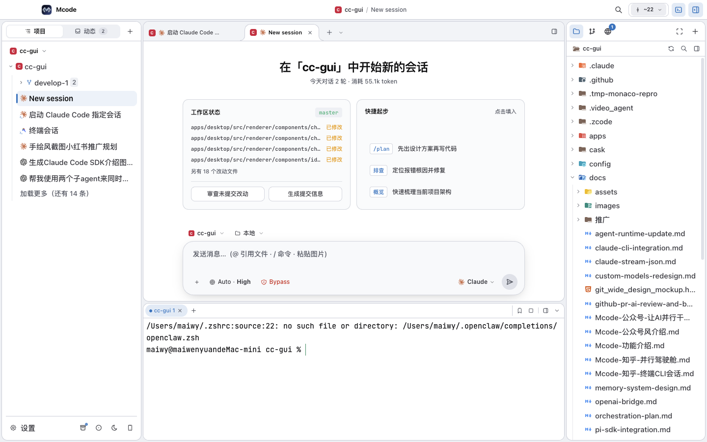

#### 🌐 右侧边栏:内置浏览器

- 主窗口之上的多 tab 浏览器面板;关闭面板页面保持存活,登录状态跨应用重启保留。
- 书签、历史、下载与隐私清理(清除 Cookie / 缓存 / 历史)。
- 设备尺寸模拟(桌面 / iPhone / Android),真实视口 + 触摸仿真;弹窗与新窗口自动站内化为标签页。
- 🎯 元素拾取:悬停高亮、点击选中,把元素的 HTML + 稳定选择器直接送入对话交给 agent。
- agent 自己也能驱动浏览器(导航 / 快照 / 点击 / 输入 / 截图,真实输入事件)完成网页端调试。

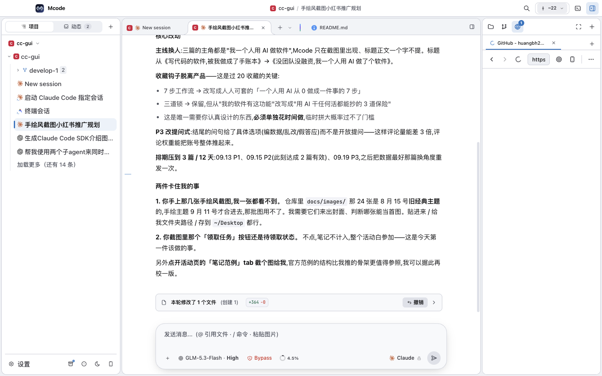

#### 🧩 插件与 MCP

- 从插件市场安装 agent 插件(git 仓库 / 本地目录 / zip 压缩包),也可添加自己的市场源;安装后默认**停用**,并弹出组件审查,确认后才可启用。
- 一个插件可携带 skills、斜杠命令、子代理、MCP server 与 hooks,Mcode 会把它们投递给**所有引擎**,并在面板中展示每个组件对各 provider 的支持矩阵(hooks 在 v1 仅解析、不执行)。
- **设置 → MCP** 可管理 MCP server:stdio / HTTP 服务器、按服务器启停,远程服务器支持 OAuth 登录。

#### 🌍 语言服务器(LSP)

- 可安装、可启停的 TS/JS、Python(basedpyright)、Go(gopls)、Java(jdtls)语言服务器。
- Monaco 内的定义跳转 / 引用 / 悬停,以及实时诊断波浪线。

#### 📱 手机端伴侣

- **局域网连接**:Mcode 在本地网络起一个伴侣 Web 服务,桌面端扫码(或手机扫码)完成配对(设备令牌认证)。
- **远程访问**:通过你自己的 VPS 建立 SSH 反向隧道,在任何网络下都能连回桌面端,无需第三方穿透服务。
- 手机是完整的遥控器:实时观看会话流式输出、发送消息、中断或撤销本轮、审批工具调用、浏览文件与 diff、执行 Git 操作(含 AI 生成提交信息)。

<table>
  <tr>
    <td>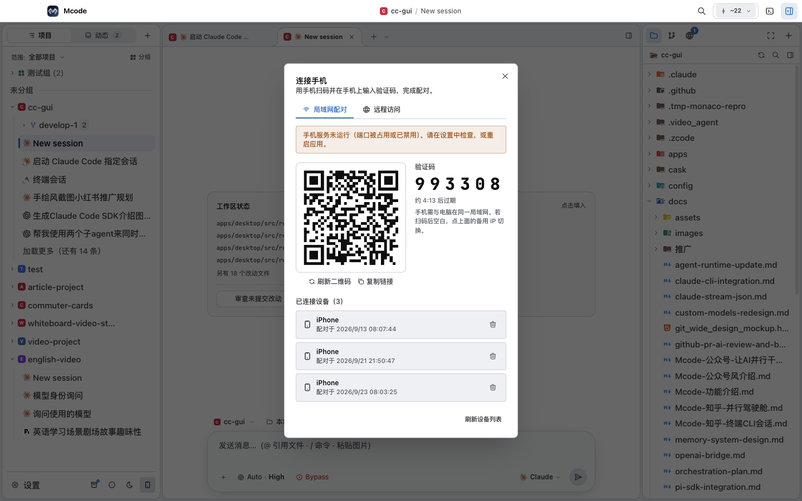</td>
    <td>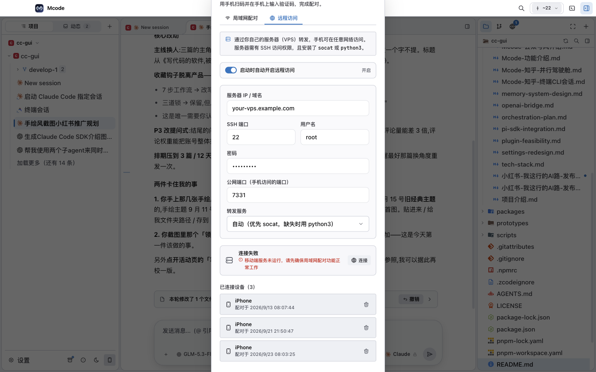</td>
  </tr>
</table>

#### ⚙️ 丰富的设置

**常规** —— 会话标题生成配置。

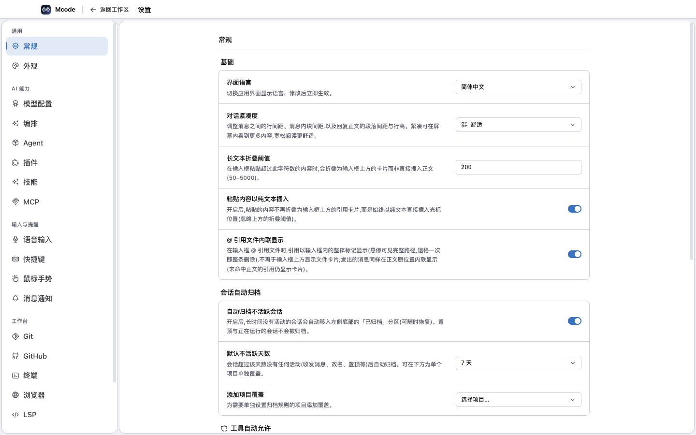

**外观** —— 主题、手绘风格(纸面浅色 / 牛皮纸深色)、界面字体、对话字号与密度。

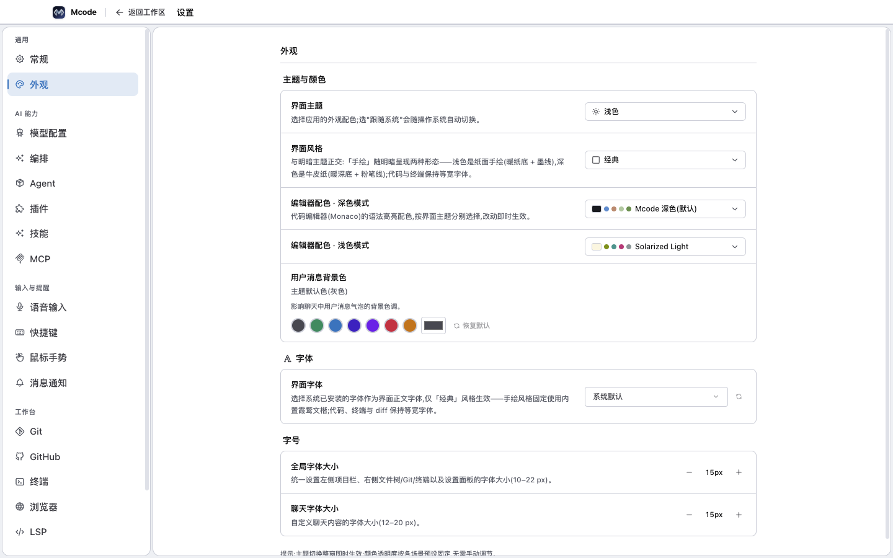

**快捷键** —— 查看与录制键盘快捷键。

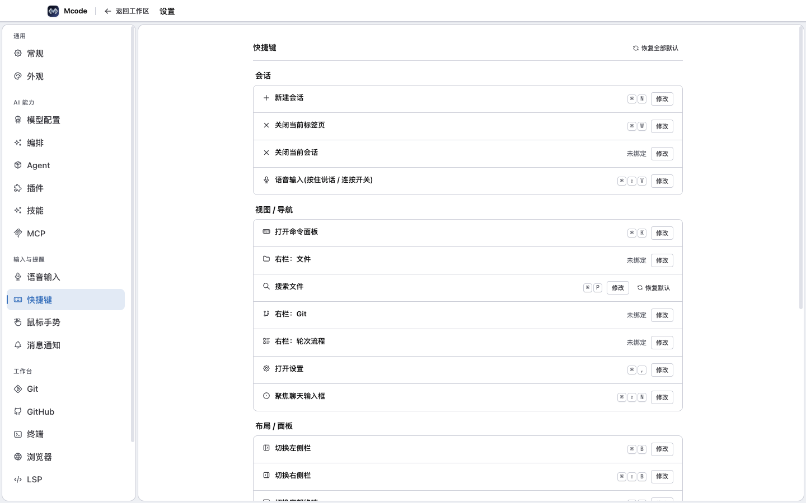

**模型配置** —— provider 与自定义模型配置(OpenAI 协议 / Anthropic 协议端点、按模型思考模式、自定义请求头、子代理模型固定)。

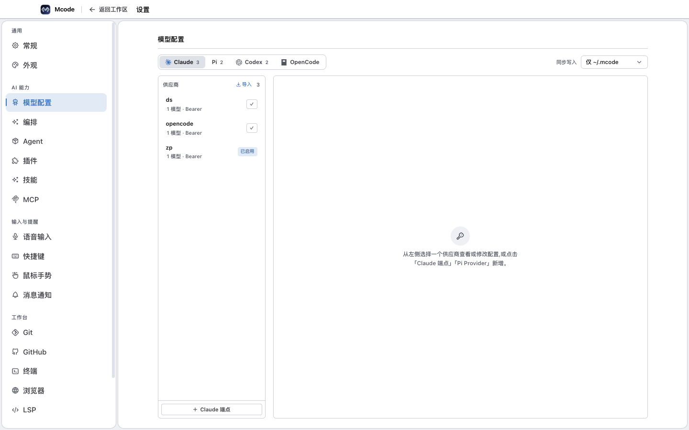

**技能** —— 管理 agent 技能,内置 SKILL.md 编辑器。

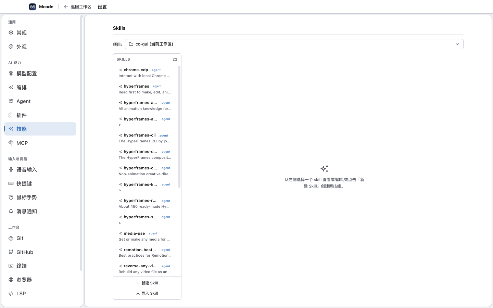

**消息通知** —— 按类别开关消息通知。

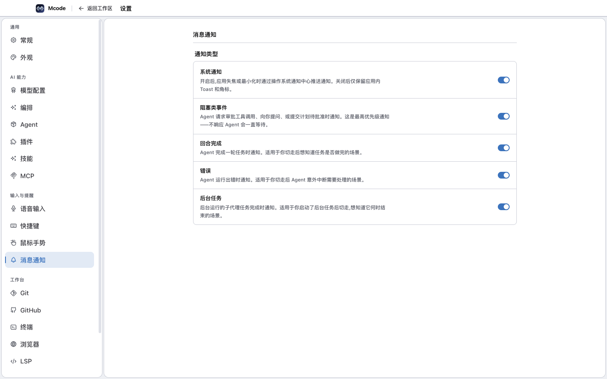

**Git** —— 作者身份、diff 选项、AI 生成提交信息所用模型。

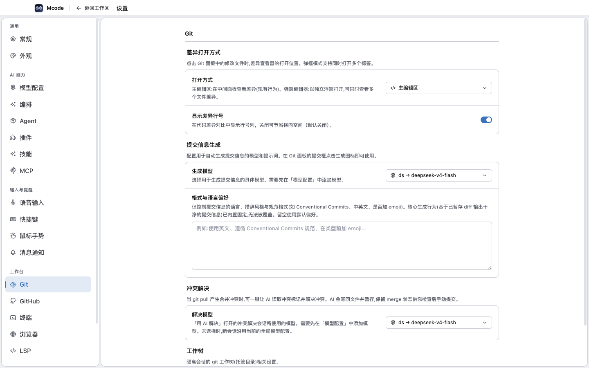

**终端** —— Shell 覆盖与项目级自定义命令。

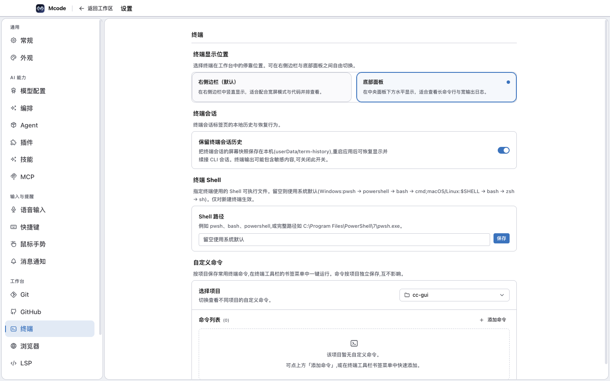

**浏览器** —— 内置浏览器偏好设置。

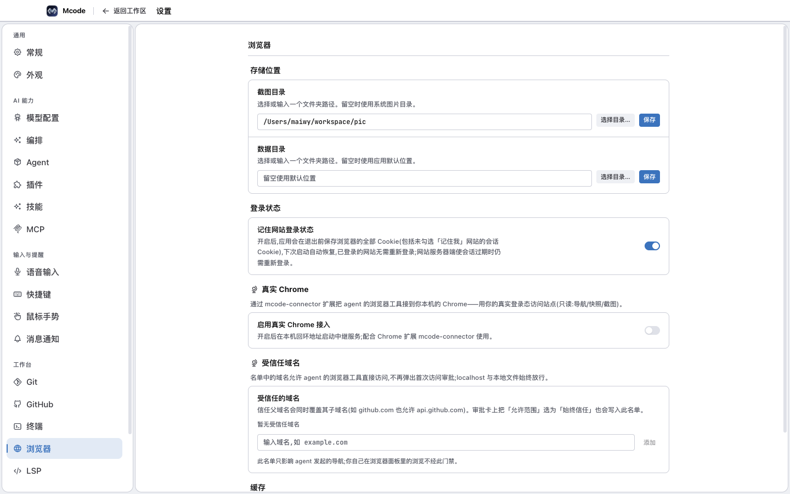

**语言服务器** —— 按语言安装、启用、停用 LSP 服务器。

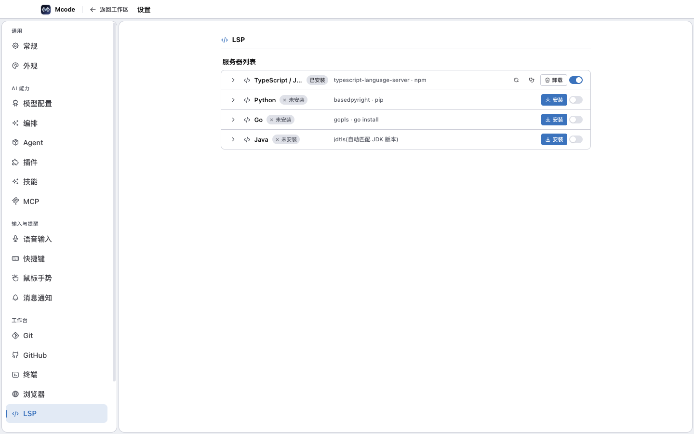

此外还有:**鼠标手势**(录制绑定到应用命令的拖拽手势)、**语音输入**、**MCP 服务器**、**插件**、**运行时**(安装/更新 Codex 与 Pi 运行时、管理终端 CLI;Claude CLI 是你自己的,不在这里管理)、**用量统计**、**关于**。

#### 🔄 其他

- **运行时按需下载** —— Codex 与 Pi 运行时不随安装包捆绑,Mcode 在首次使用时自动下载。Claude Code 与 Antigravity 的 CLI 是**你自己的**——Mcode 沿 PATH 定位并跟随你自己升级的版本(各 provider 有最低版本要求,过低时给出明确的升级提示)。
- 自动更新:通过 `electron-updater` 从 GitHub Releases 拉 `latest*.yml`;也可在**设置 → 关于**手动检查。
- Provider 抽象层(`AgentProvider`)——目前内置五个引擎,易于扩展其他 agent 平台。

### 常见问题

**Q:Mcode 免费吗?**
A:免费。Mcode 采用 **MIT 开源协议**,可自由使用和修改。

**Q:支持 macOS 和 Windows 吗?**
A:支持。已发布 macOS(Apple Silicon + Intel)与 Windows(x64)安装包,见下方[下载](#下载)。

**Q:需要单独安装 Claude Code CLI 吗?**
A:**Claude 会话需要**——而这正是特性:Mcode 跑的是*你自己的* `claude` CLI(`npm i -g @anthropic-ai/claude-code` 或原生安装器),版本、登录态、行为与你的终端完全一致。Mcode 会自动定位它,并有最低版本要求(2.1.218+),过低时给出明确升级提示。Codex 与 Pi 的运行时仍由 Mcode 自动下载;Antigravity CLI 随 Antigravity IDE / 安装器附带。

**Q:能用 Claude Pro/Max 订阅吗?**
A:可以。会话跑你自己的 Claude CLI,CLI 里登录的是什么——包括 **Pro/Max 订阅**——就用什么。API key 与第三方 Anthropic 协议端点也支持(设置 → 模型配置)。

**Q:可以用哪些模型?**
A:Claude:CLI 登录态(Pro/Max 或 API key)或自定义端点。Codex:OpenAI 官方或任意 OpenAI 协议 / Responses API 端点。Pi 与 OpenCode:在**设置 → 模型配置**里配置的模型。Antigravity:Google 账号(Antigravity 登录)、Gemini API key 或 GCP / Vertex AI 项目,支持多账号切换。

**Q:Antigravity 集成对 Google 账号安全吗?**
A:Mcode 拉起的是**未经修改的官方 `agy` CLI**,说它的**官方 ACP 协议**——与 Google 自家 IDE 相同的二进制与接口。没有逆向 API,没有凭据花招;每个保存的账号住在独立的隔离目录,配额查询走 CLI 自己的零消耗命令。详见 [Antigravity 章节](#-google-antigravitygemini)。

**Q:手机能控制 Mcode 吗?**
A:可以。局域网内扫码即可连接;也可以用自己的 VPS 建立 **SSH 反向隧道**,实现任何网络下的远程访问。

### 环境要求

- Node.js ≥ 22.13(pnpm 11 要求)
- pnpm ≥ 9(`corepack enable && corepack prepare pnpm@latest --activate`)
- **Claude provider**:已安装并登录 [Claude Code CLI](https://code.claude.com/docs/en/quickstart)(`npm i -g @anthropic-ai/claude-code`,然后运行 `claude` 登录)——版本 2.1.218+。Pro/Max 订阅或 API key 均可。
- **Codex / Pi / OpenCode provider**:在**设置 → 模型配置**中配置模型(OpenAI 官方或任意 OpenAI 协议 / Responses API 端点);运行时首次使用自动下载。在 GUI 中填写的 API key 使用 Electron `safeStorage` 加密存储。
- **Antigravity provider**:Antigravity CLI(`agy`,随 [Antigravity IDE](https://antigravity.google) 附带)——版本 1.5.5+,先 `agy acp --login` 登录,或在 Mcode 内配置 Gemini API key / GCP 账号。

> **注意**:Codex 与 Pi 无需手动安装任何 CLI——Mcode 会在首次使用时自动下载所需运行时,因此 provider 首次使用需要联网。

### 快速开始

```bash
pnpm install
pnpm dev
```

### 构建与打包

```bash
# 类型检查
pnpm typecheck

# 构建(electron-vite)
pnpm build

# 打包安装包(macOS dmg/zip + Windows nsis)-> apps/desktop/release/
pnpm package
```

### 下载

预编译二进制发布在 [GitHub Releases](https://github.com/huangbh2020/mcode/releases):

- **macOS**:`.dmg`(arm64 + x64)
- **Windows**:`.exe` NSIS 安装包(x64)

> ⚠️ **未代码签名。** Mcode 是免费的 MIT 开源项目,没有付费的 Apple Developer ID 证书,也没有 Windows 代码签名证书,因此安装包仅做了 ad-hoc 签名(macOS)/ 未签名(Windows)。首次启动时系统会弹出安全提示,属正常现象,可放心使用。下面是首次启动的处理方法。

#### 首次启动注意事项

**macOS** —— Gatekeeper 会拦截并提示 *"无法打开 Mcode,因为无法验证开发者"* / *"Apple 无法检查其是否包含恶意软件"*:

- **macOS 15(Sequoia)及更早版本**:右键点击应用 → **打开** → 在弹窗中确认。
- **macOS 26 及以上**:右键 → 打开已失效。请打开 **系统设置 → 隐私与安全性**,滚动到底部,点击 **仍要打开**。
- **终端命令(所有版本通用)**:
  ```bash
  xattr -dr com.apple.quarantine /Applications/Mcode.app
  ```
- **Homebrew(完全不提示)**:`brew install --cask mcode` —— cask 在安装时会自动去除 quarantine 属性。

**Windows** —— SmartScreen 会提示 *"Windows 已保护你的电脑"* / *"未知发布者"*:

- 点击 **更多信息** → **仍要运行**。
- 安装包(NSIS)为每用户安装,无需管理员权限。

### 技术栈

| 层 | 技术 |
|----|------|
| 壳层 | Electron 37、electron-vite、electron-builder 25 |
| 前端 | React 19、Zustand 5、Tailwind CSS 3、@base-ui/react、@tabler/icons |
| 编辑器/终端 | Monaco Editor、xterm.js + node-pty |
| Agent 引擎 | Claude Code CLI(直接拉起,stream-json 协议)· @openai/codex · pi coding agent · opencode v2 · Antigravity `agy` CLI(ACP) |
| 持久化 | better-sqlite3(同步 SQLite) |
| 契约 | zod(跨进程 IPC 校验) |
| 工具链 | pnpm 11、Turbo、TypeScript 5(strict) |

### 许可证

MIT。本项目不重新分发或内嵌任何 agent 二进制:Claude Code 与 Antigravity 的 CLI 由用户自行安装、原样拉起;Codex / Pi / OpenCode 的运行时按需从官方 npm 包获取。

### 交流群

欢迎加入 Mcode 微信交流群——使用疑问、问题反馈、功能讨论都可以在群里聊,微信扫码即可加入:


> 群二维码有时效,如提示已过期或已满员,请提 [issue](https://github.com/huangbh2020/mcode/issues) 联系我们。

---

如果 Mcode 帮到了你,欢迎 ⭐ Star 这个项目,并把链接分享给需要的人——你的每一次分享都是在帮开源项目被更多人发现。
